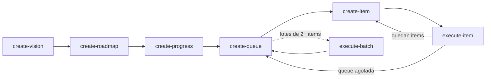

# Personalización del flujo AIDE — Guía para el equipo

> Esta guía explica cómo está montado el flujo **AI-Driven Engineering (AIDE)** en
> este repositorio, cómo extenderlo o ajustarlo, y las convenciones que todo
> cambio debe respetar. Está pensada para que cualquier integrante del equipo
> pueda modificar el proceso sin romper los comandos existentes.

---

## 1. Cómo funciona el flujo en este repositorio

AIDE se apoya en dos capas:

| Capa | Ubicación | Rol |
|---|---|---|
| **Documentos vivos** | `docs/aide/` | `vision.md`, `roadmap.md`, `progress.md`, `queue/queue-NNN.md`, `items/NNN-*.md` |
| **Comandos** | `.opencode/commands/speckit.aide.*.md` | Lo que efectivamente ejecuta opencode con `/speckit.aide.<nombre>` |

Flujo de trabajo completo:



Pasos 1–3 una sola vez; 4–6 se repiten. El paso 7 (`feedback-loop`) está
disponible en cualquier momento para corregir el proceso.

### De dónde salen los comandos

```
mnriem/spec-kit-extensions  (catálogo remoto, v1.0.0)
        │  specify extension add aide
        ▼
.specify/extensions/aide/commands/*.md      ← plantillas fuente de la extensión
.specify/extensions/aide/extension.yml      ← manifiesto (registra los 7 comandos)
        │  genera/instala
        ▼
.opencode/commands/speckit.aide.*.md        ← copias que ejecuta opencode
```

Puntos clave:

- Un comando es **solo un archivo Markdown** con frontmatter; no hay código compilado.
- `.opencode/commands/` y `.specify/extensions/aide/` están versionados en git.
- `specify extension update aide` re-descarga la extensión desde el catálogo y
  **puede pisar** ediciones locales en ambas rutas. Nada se pierde si está
  commiteado.
- opencode carga la configuración **al iniciar**: después de crear o modificar
  un comando hay que **reiniciar opencode** para que aparezca.

---

## 2. Reglas de oro del flujo

1. **Los documentos son la fuente de verdad.** El estado vive en
   `docs/aide/progress.md`, no en la memoria del chat ni en los comandos.
2. **Iconos de estado:** 📋 Planificado · 🚧 En progreso · ✅ Completo · ⏸️ Diferido · ❌ Excluido.
3. **Numeración secuencial global** de items en `queue/queue-*.md` (nunca reiniciar).
4. **Cada item tiene su ciclo:** spec en `items/NNN-*.md` → implementación → progreso.
5. **No se commitea automáticamente.** Los comandos dejan los cambios en el
   working tree; el commit lo decide una persona.
6. **Aislamiento de fallos:** un item bloqueado detiene su lote; los demás quedan en 📋.
7. **Secretos:** ningún comando debe pedir ni volcar credenciales a logs, specs o progress.

---

## 3. Cómo crear un comando nuevo (project-local)

Para capacidades propias de este proyecto, la vía recomendada es **no tocar la
extensión instalada** y crear la copia local directamente. Así el comando
sobrevive a `specify extension update`.

### Checklist

1. **Elegir nombre** con el prefijo del flujo:
   `.opencode/commands/speckit.aide.<accion>.md`
   (ej.: `speckit.aide.execute-batch.md`). Si el comando no pertenece al flujo
   AIDE, usar otro prefijo, p. ej. `odin.<accion>.md`.
2. **Crear el archivo** en `.opencode/commands/` (también es válido
   `.opencode/command/`).
3. **Frontmatter obligatorio:** `description`. Opcionales:
   `agent`, `model`, `variant`, `subtask`.
4. **Cuerpo = prompt del comando.** Usar `$ARGUMENTS` para todo el texto que
   escribe el usuario, o `$1`, `$2`, … para argumentos posicionales.
5. **Escribir precondiciones y validación explícitas** (qué leer, qué validar,
   qué hacer si falta el input). Que el comando falle con un mensaje claro
   antes que asumir.
6. **Actualizar los documentos de avance** (`progress.md`) si el comando
   completa trabajo, respetando la regla de no marcar items ajenos.
7. **Probar:** reiniciar opencode, invocar el comando **sin argumentos** (debe
   responder el mensaje de uso y no modificar nada) y con argumentos válidos.
8. **Commitear** el comando y documentarlo en la tabla de la sección 6.

### Plantilla mínima

```markdown
---
description: Resume un lote de la queue sin implementarlo.
---

# Resumen de lote

Resume los items de `docs/aide/queue/` indicados en los argumentos.

## User Input

$ARGUMENTS

## Instructions

1. Si `$ARGUMENTS` está vacío, mostrar el uso y detenerse sin modificar archivos.
2. Leer el queue correspondiente y listar cada item con su estado de `progress.md`.
3. No modificar ningún archivo.
```

### Cuándo usar comando, skill o agente

| Necesidad | Mecanismo | Ubicación |
|---|---|---|
| Acción explícita que el usuario invoca (`/...`) | **Comando** | `.opencode/commands/*.md` |
| Instrucciones que el modelo debe aplicar solo cuando detecta el contexto | **Skill** | `.opencode/skills/<nombre>/SKILL.md` |
| Rol con permisos/modelo propios (revisor, planificador) | **Agente** | `.opencode/agents/<nombre>.md` |

---

## 4. Cómo modificar un comando existente

Hay dos copias de cada comando de la extensión. Según el objetivo:

| Objetivo | Qué hacer | Riesgo |
|---|---|---|
| Ajuste **de este proyecto** a un comando de la extensión | Crear una copia local con otro nombre (p. ej. `speckit.aide.execute-item.odin.md`) o extender la lógica desde un comando nuevo | Ninguno frente a updates |
| Ajuste que debe **reemplazar** el comando original | Editar **ambas** copias: `.specify/extensions/aide/commands/X.md` y `.opencode/commands/speckit.aide.X.md` (el propio `feedback-loop.md` de AIDE lo exige) | `specify extension update aide` puede pisarlas; mitigar con git |
| Mejora **para toda la comunidad** | Enviar PR a `https://github.com/mnriem/spec-kit-extensions` | — |

> Regla práctica: si el cambio modifica el comportamiento estándar de un paso
> del flujo (visión, roadmap, queue, item…), probablemente conviene un comando
> nuevo en lugar de mutar el existente.

---

## 5. Caso real: `execute-batch`

El comando [`execute-batch`](../../.opencode/commands/speckit.aide.execute-batch.md)
nació de una limitación concreta: ejecutar un item por sesión desperdicia
contexto cuando varios items comparten archivos y decisiones técnicas.

- **Uso:** `/speckit.aide.execute-batch 020-023,027`
  — acepta rangos (`020-023`), listas (`020,021,022`) y mezclas.
- **Validaciones:** exige **al menos 2 items**; si faltan argumentos responde
  un mensaje de uso y **no procede**. Verifica que cada item exista en la queue
  y no esté ya en ✅.
- **Fases:** crear specs faltantes → implementar de a uno con `progress.md`
  actualizado por item → cierre con suite completa (`pytest`, `ruff`, `mypy`).
- **Bloqueo:** detiene el lote y deriva a `/speckit.aide.feedback-loop`.
- **Commits:** no realiza ninguno.

Los lotes de trabajo (Lote A, B, C…) se definen en `docs/aide/queue/queue-NNN.md`
y el comando recibe cada lote como lista de items.

---

## 6. Inventario de comandos

| Comando | Origen | Archivo |
|---|---|---|
| `speckit.aide.create-vision` | Extensión v1.0.0 | `.opencode/commands/speckit.aide.create-vision.md` |
| `speckit.aide.create-roadmap` | Extensión v1.0.0 | `.opencode/commands/speckit.aide.create-roadmap.md` |
| `speckit.aide.create-progress` | Extensión v1.0.0 | `.opencode/commands/speckit.aide.create-progress.md` |
| `speckit.aide.create-queue` | Extensión v1.0.0 | `.opencode/commands/speckit.aide.create-queue.md` |
| `speckit.aide.create-item` | Extensión v1.0.0 | `.opencode/commands/speckit.aide.create-item.md` |
| `speckit.aide.execute-item` | Extensión v1.0.0 | `.opencode/commands/speckit.aide.execute-item.md` |
| `speckit.aide.feedback-loop` | Extensión v1.0.0 | `.opencode/commands/speckit.aide.feedback-loop.md` |
| `speckit.aide.execute-batch` | **Local del proyecto** | `.opencode/commands/speckit.aide.execute-batch.md` |

Al agregar un comando, sumarlo a esta tabla.

---

## 7. Mantenimiento y verificación

- **Estado de la extensión:**
  `specify extension list` · `specify extension info aide`
- **Actualizar la extensión:** `specify extension update aide`. Después:
  `git diff .opencode/commands .specify/extensions/aide`. Si el update pisó un
  ajuste local, recuperarlo con `git checkout` o reaplicarlo.
- **Reinstalar desde un fork local (avanzado):**
  `specify extension add <ruta-al-fork> --dev --force` (sobrescribe la copia instalada).
- **Probar un comando sin riesgo:** invocarlo sin argumentos; todo comando bien
  diseñado debe responder un mensaje de uso y no tocar archivos. Para verificar
  que no hubo cambios: `git status`.
- **Rollback:** como `.opencode/commands/` está versionado, cualquier comando o
  ajuste se revierte con git.

---

## 8. Referencias

- AIDE upstream: <https://github.com/mnriem/spec-kit-extensions>
- Adaptación de comandos documentada por AIDE:
  `.specify/extensions/aide/commands/feedback-loop.md` (sección 3)
- Guía de opencode para comandos personalizados: <https://opencode.ai/docs/commands/>
